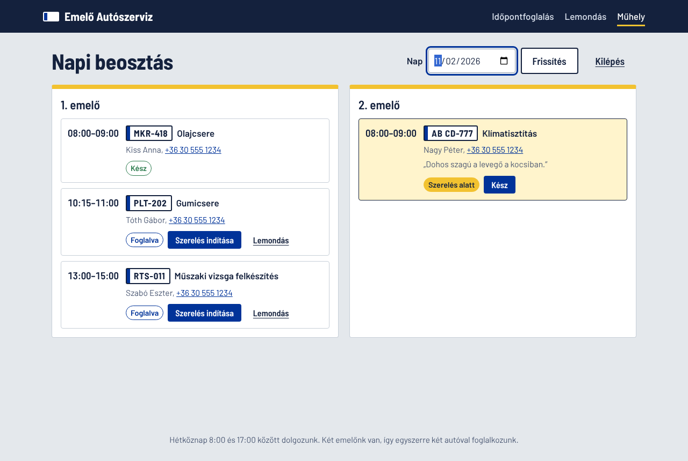
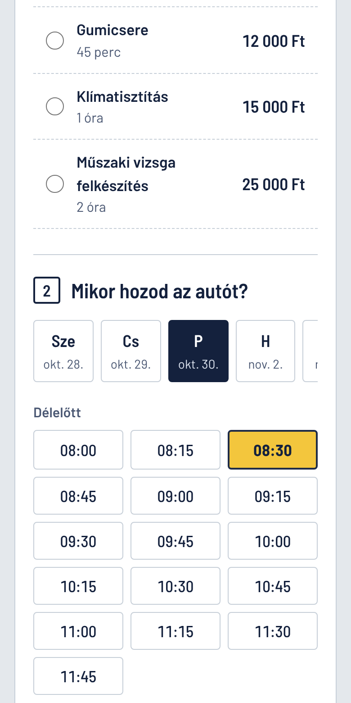

# Szerviz-foglaló – car service booking

A full-stack web app for a small car workshop: customers book a time for an oil change, brake pads or a tyre change,
and the mechanics run their day from a board that shows each lift.

**Stack:** C# / ASP.NET Core 10 Web API · Entity Framework Core (SQLite) · React 19 + TypeScript (Vite) ·
xUnit · Vitest · Docker · GitHub Actions


| Workshop board | On a phone |
|---|---|
|  |  |

*(The UI is in Hungarian: the users are a Hungarian workshop and its customers. Code and docs are in English.)*

## Features

- **Booking in three steps:** pick a service, a day and a free start time, then enter contact details and the licence plate.
- **Real scheduling rules:** two lifts, weekdays 08:00–17:00, 15-minute grid, at least 2 hours and at most 60 days
  ahead, a job must finish by closing time, the same car cannot be booked twice at overlapping times.
- **Free times are computed per lift**, so a 90-minute job only shows times when one lift is free for the whole 90 minutes.
- **Self-service cancellation** with booking number + e-mail, free until 24 hours before the start.
- **Workshop board:** bookings per lift for a day; staff move jobs Booked → In progress → Completed (or cancel).
  Protected by an admin key.
- **Hungarian licence plates** validated and formatted in both formats (`ABC-123`, `AA AA-123`), on the server and live
  in the form.

## Architecture

```
React (web/)  ──HTTP/JSON──►  ASP.NET Core API (src/ServiceBooking.Api)  ──EF Core──►  SQLite
                                 Controllers        thin: HTTP in, DTO out
                                 BookingService     every business rule, unit tested
                                 Filters            admin key, error → status code mapping
```

- **Business rules live in one class (`BookingService`)**, not in the controllers, so they can be tested without HTTP.
- **Time is injected (`IClock`)**, so tests can freeze "now" and check rules like "at least 2 hours ahead" exactly.
- **One error format:** every error is `{ "errors": ["…"] }` with a meaningful status code
  (400 invalid input, 404 not found, 409 time taken, 422 not allowed in the current state, 401 no admin key).
  The UI shows the messages as they are.
- **Validation returns every problem at once**, and the React form checks the same rules with the same wording
  before sending, so users get instant feedback.
- **One deployable unit:** in production the API also serves the built React app.

## API

| Method | Path | Who | Description |
|---|---|---|---|
| GET | `/api/services` | anyone | Services with duration and price |
| GET | `/api/availability?serviceTypeId=1&date=2026-11-03` | anyone | Free start times for a day |
| POST | `/api/bookings` | anyone | Book (201, or 400 / 409) |
| POST | `/api/bookings/{id}/cancel` | customer | Cancel with the e-mail used for booking |
| GET | `/api/bookings?date=2026-11-03` | staff | Bookings of a day |
| GET | `/api/bookings/{id}` | staff | One booking |
| POST | `/api/bookings/{id}/status` | staff | Change status |

Staff endpoints need the `X-Admin-Key` header. Interactive docs: `/swagger`.

## Tests

| Suite | Tool | Count | What it covers |
|---|---|---|---|
| Unit | xUnit | 43 | Plate rules; booking, lift assignment, time rules (with boundary values), cancellation, status transitions |
| Integration | xUnit + `WebApplicationFactory` | 11 | Real HTTP requests through the whole app with an in-memory database: status codes, JSON, admin key |
| Frontend | Vitest + Testing Library | 29 | Formatting helpers, time slot picker, booking form flow with a mocked API |
| End-to-end and API | Playwright (.NET), NUnit, Postman | 22 | Real user flows in a browser and the API contract, against the running app: **[tests/e2e](tests/e2e)**, with test plan and bug reports |

GitHub Actions builds and tests the API and the frontend on every push, then starts the whole app and runs the end-to-end tests against it.

## Running it locally

Prerequisites: [.NET 10 SDK](https://dotnet.microsoft.com/download), [Node.js 22](https://nodejs.org/).

```bash
# API on http://localhost:5080 (Swagger at /swagger). Creates servicebooking.db on first start.
cd src/ServiceBooking.Api
dotnet run

# React dev server on http://localhost:5173 (calls the API through a proxy), in a second terminal
cd web
npm install
npm run dev
```

The admin key in development is `dev-admin-key` (`appsettings.Development.json`).

```bash
dotnet test                 # API unit + integration tests (from the repo root)
cd web && npm test          # frontend tests
```

The end-to-end tests need the app running; see [tests/e2e/README.md](tests/e2e/README.md).

**Everything on one port (like production):** `cd web && npm run build:api` builds the React app into the API's
`wwwroot`; then `dotnet run` serves both on http://localhost:5080. The E2E tests use this setup.

## Deployment

The `Dockerfile` builds the React app and the API into one small image (runs as a non-root user):

```bash
docker build -t szerviz-foglalo .
docker run -p 8080:8080 -e AdminKey=valami-titkos szerviz-foglalo
```

`render.yaml` deploys it to [Render](https://render.com) as a free web service with a generated admin key.
The demo uses SQLite in the container, so data resets on every restart; a real deployment would use PostgreSQL
(only the EF Core provider and connection string change).

## What I would do next

- EF Core migrations instead of `EnsureCreated`, and PostgreSQL for persistent data
- Fix the booking race condition (two requests for the last free lift at the same moment), see BUG-002 in the [bug reports](tests/e2e/docs/BUG_REPORTS.md)
- Real staff accounts (ASP.NET Core Identity / JWT) instead of a shared admin key
- E-mail confirmation and reminder the day before
